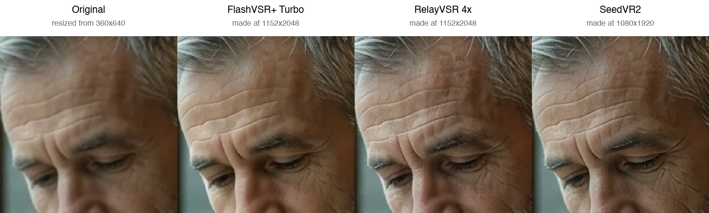

# Upscale a video

Three AI upscalers that keep faces, each in a notebook that runs on Google Colab. Upload a low-resolution clip (an AI video made at 480p, an old recording) and get a sharp one back.

| Notebook | Best at | Open |
|---|---|---|
| **FlashVSR+** | Clean and smooth; the one we tested most |  |
| **RelayVSR** | Fastest and cheapest; sharp |  |
| **SeedVR2** | The most fine texture: skin, hair, fabric; slowest |  |

Each notebook comes with a 6-second sample clip, so you can press Run before trying your own.

## Quality

The sample clip (360x640) upscaled to 1152x2048 by FlashVSR+ Turbo and by RelayVSR's 4x model run at 3.2x, and to 1080x1920 by SeedVR2: the same frame, cropped and enlarged. RelayVSR's 2x model, the notebook's default, makes 720x1280 from this clip, so beside the others it looks softer. Every notebook ends with this comparison for your own video.

## Time and cost

Measured on Google Colab on a 16-second clip at 480x854. Time and units count the upscaling only, except where a G4 figure says loading is included; the one-off setup is below.

| | Output | On a G4 | On an L4 |
|---|---|---|---|
| RelayVSR 2x | 960x1708 | 17 s for the 16 s clip, **0.18 units per minute of video** | 60 s, **0.11 units per minute** |
| FlashVSR+ Turbo | 1152x2048 | 1.2 min with loading; **0.54 units per minute** running three clips at once, loading included | 5.3 min, **0.56 units per minute** |
| SeedVR2 | 1080x1920 | 6.4 min with loading, **4.0 units per minute** | 35 min, **3.7 units per minute** |

Colab charged about 10 compute units an hour for a G4 and about 1.7 for an L4 in our runs. The G4 is 3 to 6 times faster; the L4 costs less only for RelayVSR.

**One-off, per session:** installing takes 20 seconds to 2 minutes. FlashVSR+ then loads for about a minute on an L4; RelayVSR warms up for about 40 seconds on a G4 and 2 minutes on an L4.

## Which GPU

| GPU memory | Runs |
|---|---|
| 16 GB, RTX 40 or 50 series | FlashVSR+ Turbo (12.6 GB) |
| 24 GB, like an RTX 4090 or Colab's L4 | also FlashVSR+ Base (19.3 GB), RelayVSR 2x (16.4 GB) and SeedVR2 (22.0 GB) |
| 40 GB or more, like Colab's A100 or G4 | also RelayVSR's 4x model (37 GB) |

**Colab's free T4 runs none of them.** FlashVSR+ needs a newer GPU than the T4; RelayVSR fills the free machine's 12 GB of memory; SeedVR2, in its 8-bit version with its low-memory settings, had not finished 6 seconds of video after 75 minutes. RTX 20-series cards share the T4's chip design, so FlashVSR+ will not run on them either.

On your own PC, the machine's memory counts too: FlashVSR+ reads the video in pieces in these notebooks, and the L4's machine stayed under 19 GB with a 32-second clip. Loaded whole, the same clip filled 52 GB.

## Licences

FlashVSR+, SeedVR2 (numz's command-line version) and LightX2V, which runs RelayVSR, are Apache-2.0. RelayVSR's own model pages state no licence: check before you use its results commercially. The notebooks download each model from its makers.

The sample clip was made with Google Flow. The notebooks are MIT-licensed.
